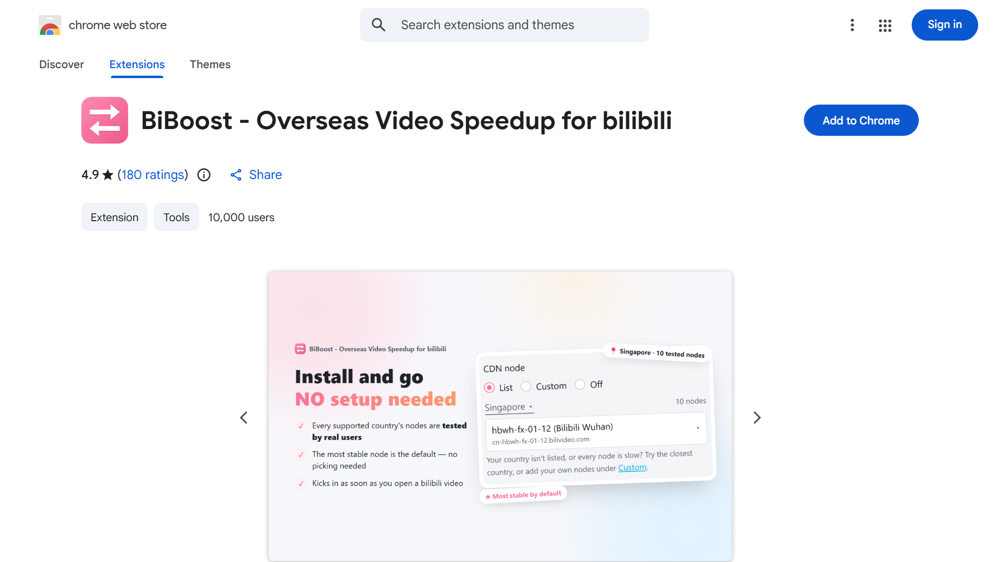
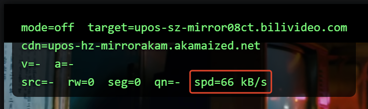
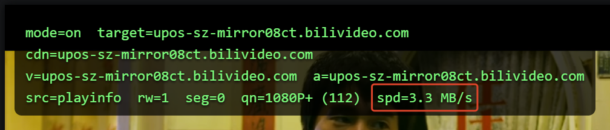

#  BiBoost - Overseas Video Speedup for bilibili

**Language:** [繁體中文](docs/README.zh-TW.md)｜[简体中文](docs/README.zh-CN.md)｜English (this page)｜[日本語](docs/README.ja.md)｜[한국어](docs/README.ko.md)

### An extension that makes bilibili web playback smoother for overseas viewers: 4K with no buffering, no more stuttering

 [Chrome Web Store](https://chromewebstore.google.com/detail/dfaddcffoondcendifiljhdbdagebgch?utm_source=github&utm_medium=referral&utm_campaign=readme&utm_content=en) 
 [Firefox Add-ons](https://addons.mozilla.org/addon/bilibili-cdn-switcher?utm_source=github&utm_medium=referral&utm_campaign=readme&utm_content=en) 
 [Edge Add-ons](https://microsoftedge.microsoft.com/addons/detail/dllallgilijcacpdemjafegibdafcbdp?utm_source=github&utm_medium=referral&utm_campaign=readme&utm_content=en) 
 [Safari (Mac)](https://apps.apple.com/app/id6817181919?platform=mac&pt=129529980&ct=github_readme_en) 
 [Safari (iPhone / iPad)](https://apps.apple.com/app/id6817181919?platform=iphone&pt=129529980&ct=github_readme_en_ios)

---

---

Before (extension off)

After (extension on)

## ✨ What this extension does

**🎯 It exists to make bilibili's web player (www.bilibili.com) smoother for overseas viewers (outside mainland China).**

| Feature | Description |
|:--|:--|
| 🚀 **Zero setup, works out of the box** | Right after installing, it works out your country from your IP in the background and switches to the CDN that tested fastest there — no need to open the settings or pick a node yourself |
| 🧑‍🔬 **Real-user speed tests, many countries** | Every country's node list is picked from speed tests run by local users on their own connections. Currently supported: Taiwan, Singapore, Hong Kong, Japan, Australia, the US, Macau, the UK, Spain and Russia, with more on the way; regions without their own list get the cross-region "Other regions" list, picked from every country's reports |
| ✏️ **Custom node list** | Tailor your own nodes to your network: download the official speed test tool **[CDNSpeedTest](https://lazy-cv.com/blog/en/notes/bilibili-cdn-speedtest?utm_source=github&utm_medium=referral&utm_campaign=readme&utm_content=en)** (Windows / Mac) and run it once, and the nodes that suit you best are added to the extension automatically; you can also enter several CDN hosts yourself, with the same speed test and sorting |
| 📶 **Per-node speed test** | A speed-test page inside the popup (shared by video and live) showing the video title/quality; measures download speed for each node using the current video at its current quality, listed one by one with a label showing whether each node is good for 8K/4K/1080p/720p or may stutter. Click any row to switch to that node; you can stop or retest mid-run, and leaving the page stops the test |
| 🔁 **Auto-optimize node on stalls** | When the video in the tab you're watching stalls (about 5 s, or 3 times within 3 minutes), or its buffer keeps running low, it speed-tests the nodes in your current list in the background and switches **only that tab** to one that can carry the current quality; your chosen node and your other tabs stay as they are. Background tabs and picture-in-picture are never switched. If no node plays smoothly, a prompt lets you keep watching, re-test, or stop the extension from intervening. Can be turned off with the "Auto-optimize node when slow" toggle in Advanced settings (on by default); turn it off if your own network is unstable |
| 📺 **Live-stream support** | The "Live" tab switches between International (ov) / International backup (ov-b) / China (cn) / China backup (cn-b) without reloading the page. Actual route URLs are shown only once you are in a live room and it is playing; routes the current stream does not have are labelled and dimmed (still selectable). When a live route performs badly, "Auto-optimize node when slow" falls back to International (ov) automatically (for that room only, without changing your long-term choice) |
| 🦊 **Chrome / Firefox / Edge / Safari** | Available on Chrome, Firefox, Edge, and Safari (Mac, iPhone, iPad) |
| 🌏 **Multi-language UI** | Automatically shows Traditional Chinese / Simplified Chinese / English / Japanese / Korean based on your browser language (or pick one manually in Advanced settings), covering the popup, in-page toasts, and the debug overlay |
| 💬 **Report a problem / Request a feature** | Report a problem or request a feature straight from the popup; once sent, an issue is opened on GitHub so you can follow its progress. The full diagnostics attached to a problem report are never made public |
| 📢 **Announcements** | The announcement bar at the top of the main page shows announcements for your country (such as speed-test prize draws); click one to read it in full |
| ☕ **Support · Top Patrons** | BiBoost is free forever; if you'd like to support development, you can tip from the main page and get onto the Top Patrons board, ranked by total amount (no tipping in the Safari version) |
| 🐛 **Debug overlay** | Shows the currently active CDN node (off by default; turn it on in Advanced settings behind the gear icon at the top right) |

---

## ☕ Buy me a coffee

BiBoost is free forever, maintained by one indie developer after work. If you like it, consider buying me a coffee! As a thank-you for your generosity, you can pick your own name and avatar to appear on the Top Patrons list.

Or scan the QR code with your phone

---

## 🔒 Privacy

What the extension accesses and why: [PRIVACY.md](PRIVACY.md)

---

## 📜 License

The source is public under a custom **[Source-Available License](LICENSE)**:

- ✅ You may view, fork, and modify the source; personal use, teaching/research, and other non-commercial uses are freely permitted
- ❌ You may not repackage this project or a modified version as a competing browser extension/app/service and publish it, nor remove copyright notices
- See [LICENSE](LICENSE) for full terms; for commercial partnerships or an exception, please open an issue

---

Made with ❤️ for bilibili viewers overseas · Inspired by [@roge4444](https://github.com/roge4444)'s [PiliNaraRogerMod](https://github.com/roge4444/PiliNaraRogerMod) / [blblRogerMod](https://github.com/roge4444/blblRogerMod)

