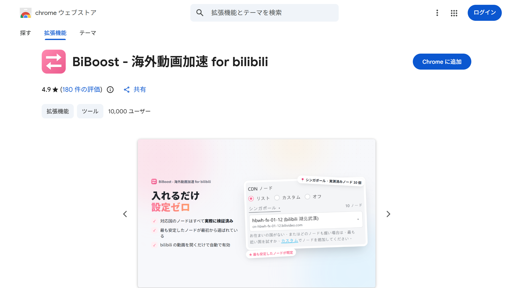
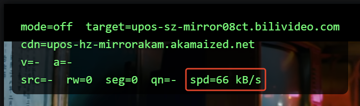
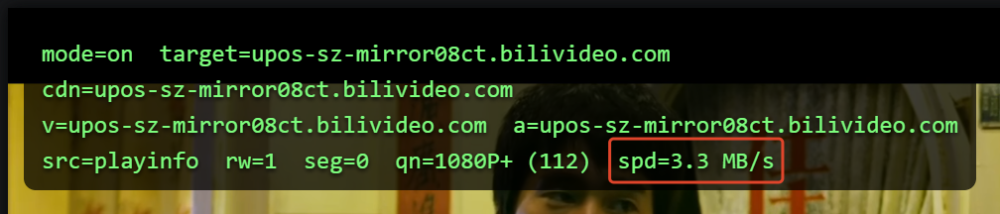
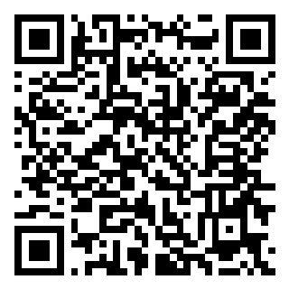

#  BiBoost - bilibili(ビリビリ)動画・配信 重い・止まる問題解消

**言語 / Language：** [繁體中文](README.zh-TW.md)｜[简体中文](README.zh-CN.md)｜[English](../README.md)｜日本語（このページ）｜[한국어](README.ko.md)

### 海外から Web 版 bilibili をもっとスムーズに。4K もバッファリングなしで再生でき、カクつきに悩まされない拡張機能

 [Chrome Web Store](https://chromewebstore.google.com/detail/dfaddcffoondcendifiljhdbdagebgch?utm_source=github&utm_medium=referral&utm_campaign=readme&utm_content=ja) 
 [Firefox Add-ons](https://addons.mozilla.org/addon/bilibili-cdn-switcher?utm_source=github&utm_medium=referral&utm_campaign=readme&utm_content=ja) 
 [Edge Add-ons](https://microsoftedge.microsoft.com/addons/detail/dllallgilijcacpdemjafegibdafcbdp?utm_source=github&utm_medium=referral&utm_campaign=readme&utm_content=ja) 
 [Safari（Mac）](https://apps.apple.com/jp/app/id6817181919?platform=mac&pt=129529980&ct=github_readme_ja) 
 [Safari（iPhone／iPad）](https://apps.apple.com/jp/app/id6817181919?platform=iphone&pt=129529980&ct=github_readme_ja_ios)

---

---

使用前（拡張機能オフ）

使用後（拡張機能オン）

## ✨ この拡張機能でできること

**🎯 海外（中国本土以外）から Web 版 bilibili（www.bilibili.com）をスムーズに見るための拡張機能です。**

| 機能 | 説明 |
|:--|:--|
| 🚀 **設定不要、すぐに使える** | インストールするとバックグラウンドで IP からお住まいの国を判定し、その国で実測して最速だった CDN に自動で切り替えます。設定を開く必要も、ノードを自分で選ぶ必要もありません |
| 🧑‍🔬 **実ユーザーによる実測、多くの国に対応** | 各国のノードリストは、現地のユーザーが自分の回線で実際にテストした結果から選んでいます。台湾、シンガポール、香港、日本、オーストラリア、アメリカ、マカオ、イギリス、スペイン、ロシアに対応済みで、ほかの国も順次追加中です。専用リストのない地域では、各国のレポートから選んだ、地域をまたいで使える「その他の地域」リストを使います |
| ✏️ **カスタムノードリスト** | ご自身のネットワーク環境に合わせた専用ノードを用意できます。公式の速度テストツール **[CDNSpeedTest](https://lazy-cv.com/blog/ja/notes/bilibili-cdn-speedtest?utm_source=github&utm_medium=referral&utm_campaign=readme&utm_content=ja)**（Windows／Mac）で一度テストすると、最適なノードが拡張機能に自動で追加されます。CDN ホストを自分で複数入力することもでき、同じく速度テストと並べ替えに対応しています |
| 📶 **ノード別速度テスト** | ポップアップ内の速度テストページ（動画・ライブ共通）で動画タイトルと画質を表示し、現在の動画・現在の画質で各ノードのダウンロード速度を実測して一覧表示します。8K／4K／1080p／720p を安定して見られるか、カクつく可能性があるかも表示します。行をクリックするとそのノードに切り替わります。テスト中は停止や再テストができ、ページを離れるとテストは中止されます |
| 🔁 **カクつき時にノードを自動最適化** | 現在の CDN でセグメントのリクエストが失敗したり、再生が止まり続けたり（バッファが満杯なだけの状態は除く）したことを検出すると、動画ごとに 1 回、まず現在のリストのノードをバックグラウンドでテストします。現在のノードが 4K の目安（25 Mbps）に届いていればそのまま、届いていなければ最初に届いたノード（どれも届かなければ最速のノード）に切り替え、選択中のノードとして保存します。それでも止まる場合は、bilibili 標準のバックアップノードへ自動で切り替えます（通知を表示。通常はページ全体の再読み込みなし）。バックアップでもだめなときはメッセージを表示し、「バックアップ URL」に切り替えるかどうかをご自身で決められます。詳細設定の「遅いときにノードを自動最適化」スイッチでオフにできます（既定はオン）。ネットワーク自体が不安定な場合はオフをおすすめします |
| 📺 **ライブ配信に対応** | 「ライブ」タブで 国際回線(ov)／国際予備回線(ov-b)／中国回線(cn)／中国予備回線(cn-b) をページ全体を再読み込みせずに切り替えられます。各回線の実際の URL はライブ配信ページで再生が始まってから表示され、現在の配信にない回線にはその旨が表示されてグレーになります（選択は可能）。ライブ回線が不調なときは、「遅いときにノードを自動最適化」が国際回線(ov) に自動で戻します（その配信だけが対象で、普段の選択は変わりません） |
| 🦊 **Chrome / Firefox / Edge / Safari の 4 プラットフォーム** | Chrome、Firefox、Edge、Safari（Mac・iPhone・iPad）で使えます |
| 🌏 **多言語 UI** | ブラウザの言語に合わせて繁体字中国語／簡体字中国語／英語／日本語／韓国語を自動表示（詳細設定で手動選択も可能）。ポップアップ、ページ内のメッセージ、デバッグ表示のすべてに対応 |
| 💬 **問題の報告／機能リクエスト** | ポップアップから直接、問題を報告したり新機能をリクエストしたりできます。送信すると GitHub に issue が作成され、進捗を追えます。問題の報告に添付される詳しい診断データは公開されません |
| 📢 **お知らせ** | メインページ上部のお知らせバーに、お住まいの国向けのお知らせ（速度テストの抽選キャンペーンなど）を表示し、開くと全文を読めます |
| ☕ **支援・石油王ランキング** | BiBoost は永久無料です。開発を応援したい方はメインページから支援でき、累計金額順の石油王ランキングに載ります（Safari 版には支援機能はありません） |
| 🐛 **デバッグ表示** | 現在の CDN ノードを確認できます（既定はオフ。右上の歯車の詳細設定でオンにできます） |

---

## ☕ コーヒーをおごってください

BiBoost は永久無料で、個人開発者が仕事終わりにメンテナンスしています。気に入っていただけたら、コーヒーを 1 杯おごってもらえるとうれしいです！感謝のしるしとして、好きな名前とアイコンで石油王ランキングに載ることができます

スマホで QR コードを読み取って支援することもできます

---

## 🔒 プライバシー

拡張機能がアクセスするデータとその用途：[PRIVACY.md](../PRIVACY.md)

---

## 📜 ライセンス

独自の **[Source-Available License](../LICENSE)** でソースを公開しています：

- ✅ ソースの閲覧、fork、改変が可能で、個人利用、教育・研究などの非商用利用は自由です
- ❌ 本プロジェクトや改変版を、競合するブラウザ拡張機能／アプリ／サービスとして再パッケージ化して公開・配布すること、著作権表示を削除することはできません
- 詳しい条文は [LICENSE](../LICENSE) を参照してください。商用での協業や例外の許諾については issue でご相談ください

---

Made with ❤️ for bilibili viewers overseas · Inspired by [@roge4444](https://github.com/roge4444)'s [PiliNaraRogerMod](https://github.com/roge4444/PiliNaraRogerMod) / [blblRogerMod](https://github.com/roge4444/blblRogerMod)

