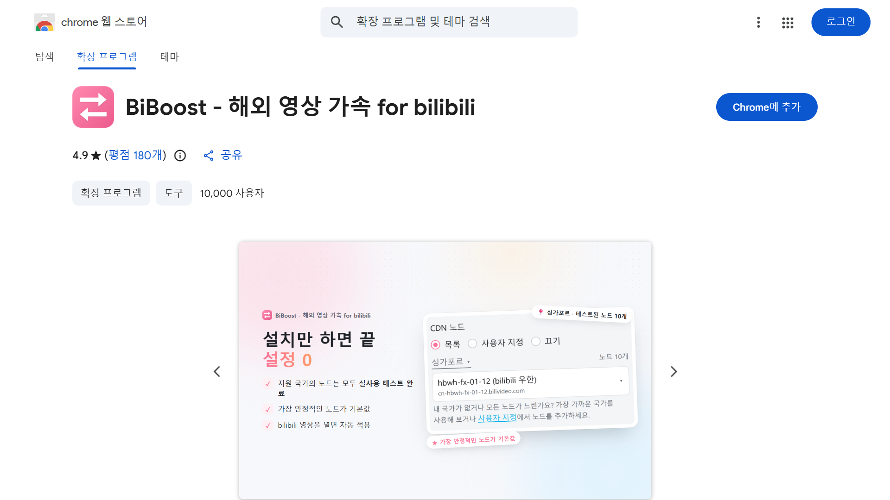
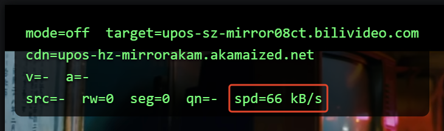
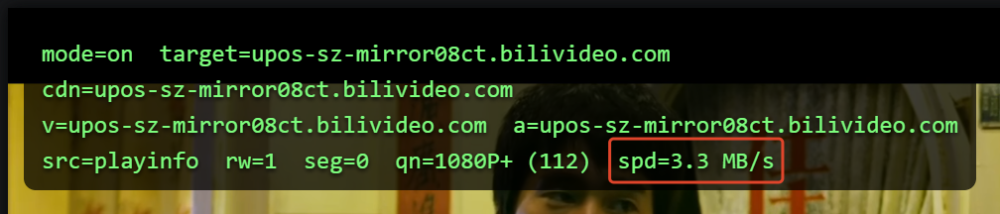

#  BiBoost - 해외 영상 가속 for bilibili

**언어 / Language：** [繁體中文](README.zh-TW.md)｜[简体中文](README.zh-CN.md)｜[English](../README.md)｜[日本語](README.ja.md)｜한국어(이 페이지)

### 해외에서 웹 bilibili를 더 매끄럽게, 버퍼링 없이 4K로 재생하고 더 이상 끊김에 시달리지 않는 확장 프로그램

 [Chrome Web Store](https://chromewebstore.google.com/detail/dfaddcffoondcendifiljhdbdagebgch?utm_source=github&utm_medium=referral&utm_campaign=readme&utm_content=ko) 
 [Firefox Add-ons](https://addons.mozilla.org/addon/bilibili-cdn-switcher?utm_source=github&utm_medium=referral&utm_campaign=readme&utm_content=ko) 
 [Edge Add-ons](https://microsoftedge.microsoft.com/addons/detail/dllallgilijcacpdemjafegibdafcbdp?utm_source=github&utm_medium=referral&utm_campaign=readme&utm_content=ko) 
 [Safari(Mac)](https://apps.apple.com/kr/app/id6817181919?platform=mac&pt=129529980&ct=github_readme_ko) 
 [Safari(iPhone / iPad)](https://apps.apple.com/kr/app/id6817181919?platform=iphone&pt=129529980&ct=github_readme_ko_ios)

---

---

사용 전(확장 프로그램 끔)

사용 후(확장 프로그램 켬)

## ✨ 이 확장 프로그램이 하는 일

**🎯 해외(중국 본토 외) 사용자가 웹 bilibili(www.bilibili.com)를 더 매끄럽게 볼 수 있도록 만든 확장 프로그램입니다.**

| 기능 | 설명 |
|:--|:--|
| 🚀 **설정 없이 바로 사용** | 설치하면 백그라운드에서 IP로 사용자 국가를 판단해, 그 국가에서 실측해 가장 빨랐던 CDN으로 자동 전환합니다. 설정을 열 필요도, 노드를 직접 고를 필요도 없습니다 |
| 🧑‍🔬 **실사용자 실측, 다국가 지원** | 국가별 노드 목록은 모두 현지 사용자가 자신의 네트워크로 직접 실측한 결과로 골랐습니다. 대만, 싱가포르, 홍콩, 일본, 호주, 미국, 마카오, 영국, 스페인, 러시아를 지원하며 다른 국가도 순차 추가 중입니다. 전용 목록이 없는 지역에서는 각국 보고서에서 골라낸, 여러 지역에서 두루 쓸 수 있는 「기타 지역」 목록을 사용합니다 |
| ✏️ **사용자 지정 노드 목록** | 사용자 네트워크 환경에 맞춘 전용 노드를 만들 수 있습니다. 공식 속도 테스트 도구 **[CDNSpeedTest](https://lazy-cv.com/blog/en/notes/bilibili-cdn-speedtest?lang=ko&utm_source=github&utm_medium=referral&utm_campaign=readme&utm_content=ko)**(Windows / Mac)로 한 번 테스트하면 가장 잘 맞는 노드가 확장 프로그램에 자동으로 추가됩니다. CDN 호스트를 직접 여러 개 입력할 수도 있으며, 마찬가지로 속도 테스트와 정렬을 지원합니다 |
| 📶 **노드별 속도 테스트** | 팝업 안의 속도 테스트 페이지(영상·라이브 공용)에서 영상 제목과 화질을 보여 주고, 현재 영상·현재 화질에서 각 노드의 다운로드 속도를 실측해 하나씩 나열하며, 8K / 4K / 1080p / 720p를 원활하게 볼 수 있는지 끊길 수 있는지 표시합니다. 아무 행이나 누르면 그 노드로 전환되고, 테스트 중에도 중지하거나 다시 테스트할 수 있으며, 페이지를 벗어나면 테스트가 중단됩니다 |
| 🔁 **끊김 시 노드 자동 최적화** | 현재 CDN의 세그먼트 요청 실패나 계속되는 재생 멈춤(단순히 버퍼가 가득 찬 상태는 제외)을 감지하면, 영상마다 한 번 먼저 현재 목록의 노드를 백그라운드에서 테스트합니다. 현재 노드가 4K 기준(25 Mbps)에 도달하면 그대로 두고, 아니면 처음으로 기준에 도달한 노드(모두 미달이면 가장 빨랐던 노드)로 바꿔 사용자 노드로 저장합니다. 그래도 멈추면 bilibili가 기본 제공하는 백업 노드로 조용히 전환하고(알림 표시, 보통 페이지 전체 새로고침 없음), 백업도 안 되면 「백업 URL」로 전환할지 직접 정할 수 있도록 알림을 띄웁니다. 고급 설정의 「느릴 때 노드 자동 최적화」 스위치로 끌 수 있으며(기본값은 켬), 네트워크 자체가 불안정하다면 끄는 것을 권장합니다 |
| 📺 **라이브 방송 지원** | 「라이브」 탭에서 국제 회선(ov) / 국제 예비 회선(ov-b) / 중국 회선(cn) / 중국 예비 회선(cn-b)을 페이지 전체 새로고침 없이 전환할 수 있습니다. 각 회선의 실제 URL은 라이브 방송 페이지에서 재생이 시작된 뒤에 표시되며, 현재 방송에 없는 회선은 그렇다고 표시되고 흐리게 나타납니다(선택은 가능). 라이브 회선 상태가 나쁘면 「느릴 때 노드 자동 최적화」가 국제 회선(ov)으로 자동으로 되돌립니다(해당 라이브 방송에만 적용되며 평소 선택은 바꾸지 않음) |
| 🦊 **Chrome / Firefox / Edge / Safari 4개 플랫폼** | Chrome, Firefox, Edge, Safari(Mac, iPhone, iPad)에서 사용할 수 있습니다 |
| 🌏 **다국어 UI** | 브라우저 언어에 맞춰 繁體中文 / 简体中文 / English / 日本語 / 한국어를 자동으로 표시합니다(고급 설정에서 직접 선택도 가능). 팝업, 페이지 내 알림, 디버그 오버레이 모두 지원합니다 |
| 💬 **문제 신고 / 기능 요청** | 팝업에서 바로 문제를 신고하거나 새 기능을 요청할 수 있으며, 보내면 GitHub에 issue가 열려 진행 상황을 확인하기 쉽습니다. 문제 신고에 첨부되는 전체 진단 데이터는 공개되지 않습니다 |
| 📢 **공지** | 메인 페이지 위쪽의 공지 바에 사용자 국가의 공지(예: 속도 테스트 추첨 이벤트)가 표시되며, 누르면 전문을 볼 수 있습니다 |
| ☕ **후원 · 회장님 랭킹** | BiBoost는 영원히 무료입니다. 개발을 응원하고 싶다면 메인 페이지에서 후원할 수 있고, 누적 금액 순으로 정렬되는 회장님 랭킹에 오르게 됩니다(Safari 버전에는 후원 기능이 없음) |
| 🐛 **디버그 오버레이** | 현재 CDN 노드를 확인할 수 있습니다(기본값은 끔. 오른쪽 위 톱니바퀴의 고급 설정에서 켤 수 있습니다) |

---

## ☕ 커피 한 잔 사 주세요

BiBoost는 영원히 무료이며, 1인 개발자가 퇴근 후에 관리하고 있습니다. 마음에 드셨다면 커피 한 잔 사 주세요! 감사의 뜻으로 원하는 이름과 프로필 사진으로 회장님 랭킹에 올라갈 수 있어요

휴대폰으로 QR 코드를 스캔해서 후원할 수도 있습니다

---

## 🔒 개인정보

확장 프로그램이 접근하는 데이터와 그 용도: [PRIVACY.md](../PRIVACY.md)

---

## 📜 라이선스

자체 **[Source-Available License](../LICENSE)**로 소스를 공개합니다:

- ✅ 소스 열람, fork, 수정이 가능하며 개인 사용, 교육·연구 등 비상업적 용도는 자유롭게 허용됩니다
- ❌ 이 프로젝트나 수정본을 경쟁 브라우저 확장 프로그램/앱/서비스로 다시 패키징해 배포하거나 스토어에 올릴 수 없으며, 저작권 표시를 삭제할 수 없습니다
- 전체 조항은 [LICENSE](../LICENSE)를 참고하세요. 상업적 협업이나 예외 허가는 issue로 문의해 주세요

---

Made with ❤️ for bilibili viewers overseas · Inspired by [@roge4444](https://github.com/roge4444)'s [PiliNaraRogerMod](https://github.com/roge4444/PiliNaraRogerMod) / [blblRogerMod](https://github.com/roge4444/blblRogerMod)

