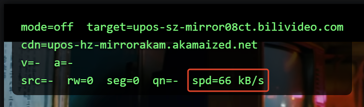
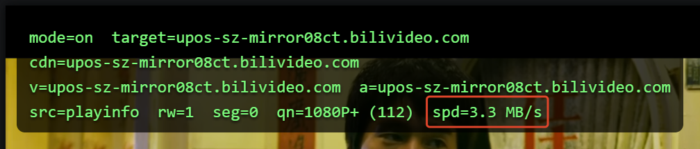

#  哔速 - 解决B站卡顿,视频直播加速加载 for bilibili

**语言 / Language：** [繁體中文](README.zh-TW.md)｜简体中文（本页）｜[English](../README.md)｜[日本語](README.ja.md)｜[한국어](README.ko.md)

### 让海外用户看网页版 B 站更顺，无缓冲播放 4K，不再遭受卡顿的扩展

 [Chrome Web Store](https://chromewebstore.google.com/detail/dfaddcffoondcendifiljhdbdagebgch?utm_source=github&utm_medium=referral&utm_campaign=readme&utm_content=zhcn) 
 [Firefox Add-ons](https://addons.mozilla.org/addon/bilibili-cdn-switcher?utm_source=github&utm_medium=referral&utm_campaign=readme&utm_content=zhcn) 
 [Edge Add-ons](https://microsoftedge.microsoft.com/addons/detail/dllallgilijcacpdemjafegibdafcbdp?utm_source=github&utm_medium=referral&utm_campaign=readme&utm_content=zhcn) 
 [Safari（Mac）](https://apps.apple.com/us/app/id6817181919?platform=mac&l=zh-Hans-CN&pt=129529980&ct=github_readme_zhcn) 
 [Safari（iPhone／iPad）](https://apps.apple.com/us/app/id6817181919?platform=iphone&l=zh-Hans-CN&pt=129529980&ct=github_readme_zhcn_ios)

---

---

使用前（关闭扩展）

使用后（启用扩展）

## ✨ 这个扩展在做什么

**🎯 主要是为了让海外（中国大陆以外）的用户看网页版 B 站（www.bilibili.com）更顺。**

| 功能 | 说明 |
|:--|:--|
| 🚀 **零设置，开箱即用** | 安装后就在后台按 IP 判断你所在的国家，自动换成该国实测最快的 CDN，不用打开设置、也不用自己挑节点 |
| 🧑‍🔬 **真人测速，多国支持** | 每个国家的节点列表，都是当地用户用自己的网络真人实测后挑出来的。已支持台湾、新加坡、香港、日本、澳大利亚、美国、澳门、英国、西班牙、俄罗斯，其他国家陆续上线；没有专属列表的地区，会使用从各国报告中挑出、跨地区通用的「其他地区」列表 |
| ✏️ **自定义节点列表** | 按你的网络环境定制专属节点：下载官方测速工具 **[CDNSpeedTest](https://lazy-cv.com/blog/zh-TW/notes/bilibili-cdn-speedtest?lang=zh-CN&utm_source=github&utm_medium=referral&utm_campaign=readme&utm_content=zhcn)**（Windows／Mac）测一次，最适合你的节点会自动加进扩展；也可以自己输入多个 CDN host，同样支持测速与排序 |
| 📶 **各节点测速** | popup 内的测速页（视频、直播共用），显示视频标题／画质，实测当前视频、当前画质下各节点的下载速度并逐一列出，标示够看 8K／4K／1080P／720P 还是可能卡顿；点任一行就切换到该节点，测速中可以停止或重新测，离开该页即中止 |
| 🔁 **卡顿自动优化节点** | 正在看的标签页卡住（约 5 秒，或 3 分钟内卡 3 次），或前方缓冲一直不够时，在后台测当前列表的节点，**只把这个标签页**换到撑得住当前画质的节点；你选的节点和其他标签页都不受影响，后台标签页与画中画一律不会被换。所有节点都不流畅时弹出提示，可以继续观看、重新测速或关闭扩展介入。可在高级设置的「速度不佳时自动优化节点」开关关闭（默认开启）；网络本身不稳时建议关闭 |
| 📺 **直播支持** | 「直播」标签页可在 国际线路(ov)／国际备用线路(ov-b)／中国线路(cn)／中国备用线路(cn-b) 之间切换，不整页重载；进入直播间播放后才会显示各线路的实际地址，当前直播没有的线路会标注并变淡（仍可选）。直播线路不佳时，「速度不佳时自动优化节点」会自动退回国际线路(ov)（只针对该直播间，不改变你长期的选择） |
| 🦊 **Chrome / Firefox / Edge / Safari 四平台** | Chrome、Firefox、Edge 和 Safari（Mac、iPhone、iPad）都能安装 |
| 🌏 **多语言界面** | 按浏览器语言自动显示繁體中文／简体中文／English／日本語／한국어（也可在高级设置手动选择），涵盖 popup、页面提示与 debug 浮层 |
| 💬 **问题反馈／功能许愿** | 在 popup 里直接反馈问题或许愿新功能，提交后会在 GitHub 开 issue 方便跟踪进度；反馈问题时附上的完整诊断数据不会公开 |
| 📢 **公告** | 主页上方的公告栏显示你所在国家的公告（例如测速抽奖活动），点开可看全文 |
| ☕ **赞助・金主爸爸排行榜** | 哔速永久免费；想支持开发可以从主页赞助，并登上按累计金额排序的金主爸爸排行榜（Safari 版没有赞助） |
| 🐛 **debug 浮层** | 查看当前 CDN 节点（默认关闭，可在右上角齿轮的高级设置中打开） |

---

## ☕ 请我喝杯咖啡

哔速永久免费，由一位独立开发者下班后维护。如果你喜欢它，欢迎请我喝杯咖啡！为了感谢你的慷慨，可以自选名字与头像登上金主爸爸榜哦

用手机扫码也能赞助

---

## 🔒 隐私

扩展会访问哪些数据、用途是什么：[PRIVACY.md](../PRIVACY.md)

---

## 📜 授权 License

源码公开，采用自定义的 **[Source-Available License](../LICENSE)**：

- ✅ 可以查看、Fork、修改源码，个人使用、教学／研究等非商业用途均可自由进行
- ❌ 不可将本项目或修改版重新包装成竞争性的浏览器扩展／App／服务并对外发布上架，也不可移除版权声明
- 完整条款请见 [LICENSE](../LICENSE)；商业合作或例外授权需求欢迎开 issue 联系

---

Made with ❤️ for bilibili viewers overseas · 灵感致谢 [@roge4444](https://github.com/roge4444) 的 [PiliNaraRogerMod](https://github.com/roge4444/PiliNaraRogerMod) ／ [blblRogerMod](https://github.com/roge4444/blblRogerMod)

