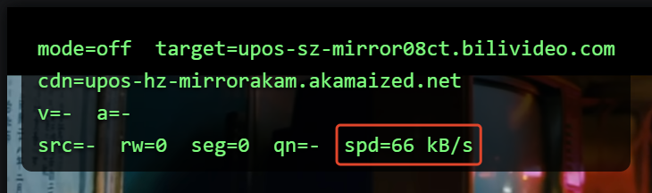
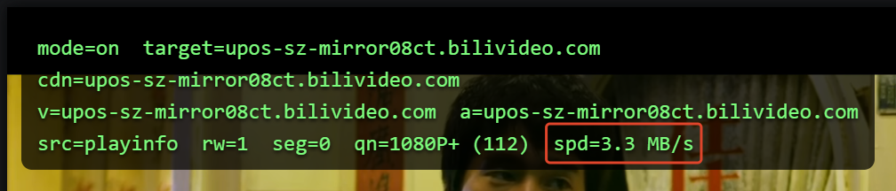

#  嗶速 - 海外影片加速 for bilibili

**語言 / Language：** 繁體中文（本頁）｜[简体中文](README.zh-CN.md)｜[English](../README.md)｜[日本語](README.ja.md)｜[한국어](README.ko.md)

### 讓海外用戶看網頁版 B 站更順，無緩衝播放 4K，不再遭受卡頓的擴充

 [Chrome Web Store](https://chromewebstore.google.com/detail/dfaddcffoondcendifiljhdbdagebgch?utm_source=github&utm_medium=referral&utm_campaign=readme&utm_content=zhtw) 
 [Firefox Add-ons](https://addons.mozilla.org/addon/bilibili-cdn-switcher?utm_source=github&utm_medium=referral&utm_campaign=readme&utm_content=zhtw) 
 [Edge Add-ons](https://microsoftedge.microsoft.com/addons/detail/dllallgilijcacpdemjafegibdafcbdp?utm_source=github&utm_medium=referral&utm_campaign=readme&utm_content=zhtw) 
 [Safari（Mac）](https://apps.apple.com/tw/app/id6817181919?platform=mac&pt=129529980&ct=github_readme_zhtw) 
 [Safari（iPhone／iPad）](https://apps.apple.com/tw/app/id6817181919?platform=iphone&pt=129529980&ct=github_readme_zhtw_ios)

---

---

使用前（關閉擴充）

使用後（啟用擴充）

## ✨ 這個擴充在做什麼

**🎯 主要是為了讓海外（中國大陸以外）的使用者看網頁版 B 站（www.bilibili.com）更順。**

| 功能 | 說明 |
|:--|:--|
| 🚀 **0 設定，開箱即用** | 安裝後就在背景依 IP 判斷你所在的國家，自動換成該國實測最快的 CDN，不用打開設定、也不用自己挑節點 |
| 🧑‍🔬 **真人測速，多國支援** | 每個國家的節點清單，都是當地使用者用自己的網路真人實測後挑出來的。已支援台灣、新加坡、香港、日本、澳洲、美國、澳門、英國、西班牙、俄羅斯，其他國家陸續上線；沒有專屬清單的地區，會用從各國報告挑出、跨地區通用的「其他地區」清單 |
| ✏️ **自訂節點列表** | 按照你的網路環境客製專屬節點：下載官方測速工具 **[CDNSpeedTest](https://lazy-cv.com/blog/zh-TW/notes/bilibili-cdn-speedtest?utm_source=github&utm_medium=referral&utm_campaign=readme&utm_content=zhtw)**（Windows／Mac）測一次，最適合你的節點會自動加進擴充；也可以自己輸入多個 CDN host，同樣支援測速與排序 |
| 📶 **各節點測速** | popup 內的測速頁（影片、直播共用），顯示影片標題／畫質，實測當前影片、當前畫質下各節點的下載速度並逐一列出，標示夠看 8K／4K／1080P／720P 還是可能卡頓；點任一列就切換到該節點，測速中可以停止或重新測，離開該頁即中止 |
| 🔁 **卡頓自動優化節點** | 正在看的分頁卡住（約 5 秒，或 3 分鐘內卡 3 次），或前方緩衝一直不夠時，在背景測目前清單的節點，**只把這個分頁**換到撐得住目前畫質的節點；你選的節點和其他分頁都不受影響，背景分頁與子母畫面一律不會被換。所有節點都不流暢時跳出提示，可以繼續觀看、重新測速或關閉擴充介入。可在進階設定的「速度不佳時自動優化節點」開關關閉（預設開啟）；網路本身不穩時建議關閉 |
| 📺 **直播支援** | 「直播」分頁可在 國際線路(ov)／國際備用線路(ov-b)／中國線路(cn)／中國備用線路(cn-b) 之間切換，不整頁重載；進入直播間播放後才會顯示各線路的實際網址，當前直播沒有的線路會標註並變淡（仍可選）。直播線路不佳時，「速度不佳時自動優化節點」會自動退回國際線路(ov)（只針對該直播間，不改變你長期的選擇） |
| 🦊 **Chrome / Firefox / Edge / Safari 四平台** | Chrome、Firefox、Edge 與 Safari（Mac、iPhone、iPad）都能安裝 |
| 🌏 **多語系介面** | 依瀏覽器語言自動顯示繁體中文／简体中文／English／日本語／한국어（也可在進階設定手動選擇），涵蓋 popup、頁面提示與 debug 疊層 |
| 💬 **問題回報／功能許願** | 在 popup 裡直接回報問題或許願新功能，送出後會在 GitHub 開 issue 方便追蹤進度；回報問題時附上的完整診斷資料不會公開 |
| 📢 **公告** | 主頁上方的公告列顯示你所在國家的公告（例如測速抽獎活動），點開可看全文 |
| ☕ **贊助・乾爹排行榜** | 嗶速永久免費；想支持開發可以從主頁贊助，並登上依累計金額排序的乾爹排行榜（Safari 版沒有贊助） |
| 🐛 **debug 疊層** | 查看當前 CDN 節點（預設關閉，可在右上角齒輪的進階設定中打開） |

---

## ☕ 請我喝杯咖啡

嗶速永久免費，由一位獨立開發者下班後維護。如果你喜歡它，歡迎請我喝杯咖啡！為了感謝你的慷慨，可以自選名字與頭像登上乾爹列表喔

用手機掃 QR code 也能贊助

---

## 🔒 隱私

擴充會存取哪些資料、用途是什麼：[PRIVACY.md](../PRIVACY.md)

---

## 📜 授權 License

原始碼公開，採自訂的 **[Source-Available License](../LICENSE)**：

- ✅ 可以查看、Fork、修改原始碼，個人使用、教學／研究等非商業用途皆可自由進行
- ❌ 不可將本專案或修改版重新包裝成競爭性的瀏覽器擴充／App／服務並對外發佈上架，也不可移除版權聲明
- 完整條款請見 [LICENSE](../LICENSE)；商業合作或例外授權需求歡迎開 issue 聯絡

---

Made with ❤️ for bilibili viewers overseas · 靈感致謝 [@roge4444](https://github.com/roge4444) 的 [PiliNaraRogerMod](https://github.com/roge4444/PiliNaraRogerMod) ／ [blblRogerMod](https://github.com/roge4444/blblRogerMod)

